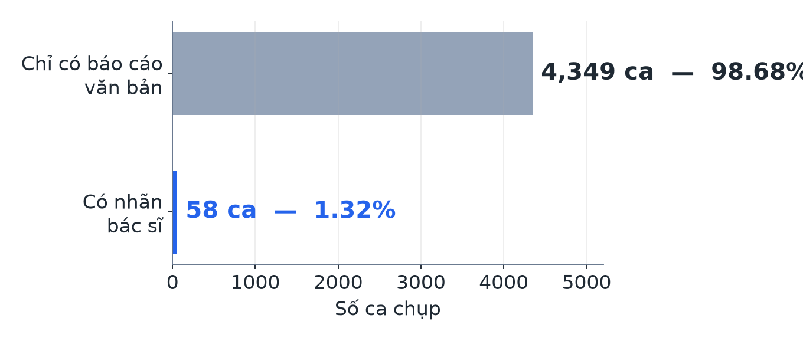
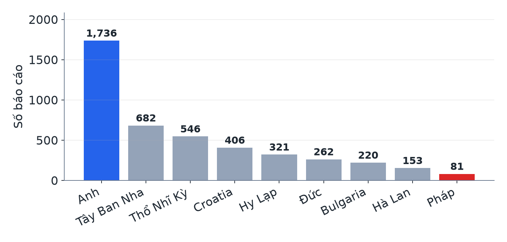
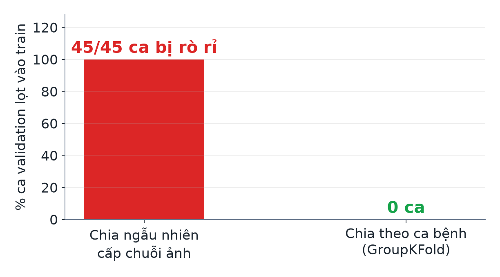
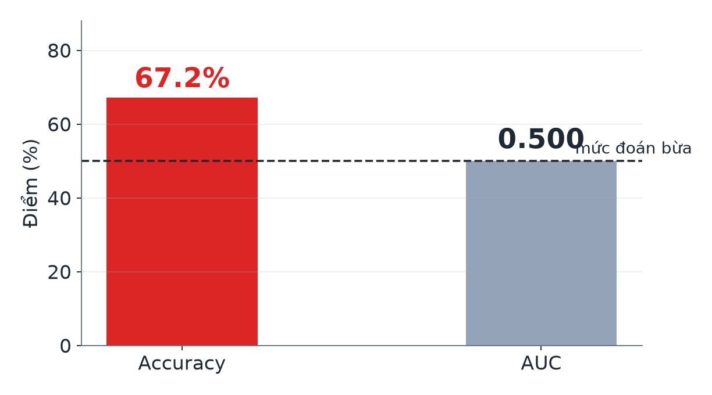
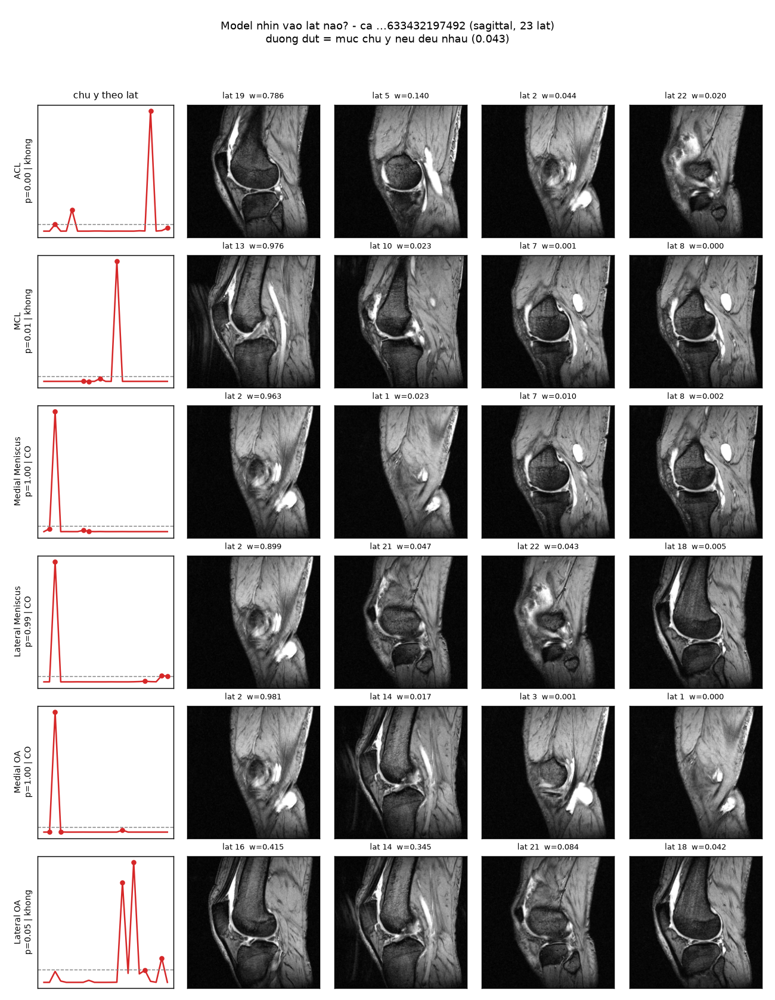
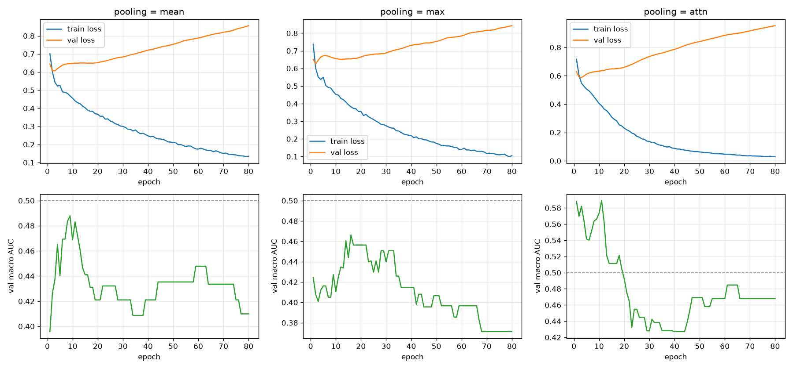

# RSNA Knee Abnormality Detection

Dự đoán 12 bất thường đầu gối từ MRI đa mặt phẳng, trong điều kiện **chỉ 1,3% dữ liệu có nhãn người gán**. Dữ liệu lấy từ [cuộc thi RSNA Knee Abnormality Detection trên Kaggle](https://www.kaggle.com/competitions/rsna-knee-abnormality-detection).

Toàn bộ pipeline tự dựng từ file DICOM thô tới dự đoán, không dùng lại checkpoint của người khác. Dự án làm trong khuôn khổ PBL.

*[English version →](README.md)* · **Báo cáo trực quan:** `reports/bao_cao_pbl.html` · **Slide:** `reports/slide/bao_cao_pbl.pptx`

---

## Kết quả

**Macro AUC `0.7645`**, khoảng tin cậy 95% `[0.715, 0.805]`. Đây là AUC out-of-fold trên 58 ca bác sĩ gán nhãn, của bộ gộp 5 head × 3 seed, mỗi head train 9 epoch. Số epoch được chốt trước mà không nhìn tới 58 ca này.

Các bước cải tiến, đo theo giao thức cũ (dùng để so các bước với nhau, không phải điểm cuối):

| Bước | Macro AUC (CV) |
|---|---:|
| Baseline đoán mò | 0.500 |
| DINOv2 đóng băng, 58 ca, 1 mặt phẳng | 0.5256 |
| + 3 mặt phẳng (149k → 437k lát) | 0.6266 |
| + nhãn máy từ từ điển luật | 0.6923 |
| + nhãn LLM thay từ điển | 0.7467 |
| + attention riêng từng bệnh | 0.7698 |
| Gộp 5 model (giao thức cũ) | 0.8112 |
| **Gộp 5 model × 3 seed, giao thức đã sửa** | **0.7645** |

### Đo lại: con số 0.8112 lạc quan vì hai lý do

**Lý do thứ nhất: chọn nhiều lần trên cùng 58 ca.** Từ lúc có nhãn từ điển tới bộ gộp, mọi lựa chọn đều được quyết bằng cách so điểm trên đúng 58 ca đánh giá:

| Chọn gì | Số lựa chọn |
|---|---:|
| Nguồn nhãn | 3 |
| Kiểu pooling | 4 |
| Backbone | 2 |
| Tổ hợp gộp | 26 |

Phép đo phương sai seed *(Mục 4)* cho thấy nhặt seed tốt nhất trong 5 đã làm điểm phồng `+0.005`. Nhặt qua ~35 lựa chọn thì phồng nhiều hơn thế.

**Lý do thứ hai, cụ thể hơn và sửa được: CV đo một model, model cuối là model khác** (ngày 13, `scripts/48_do_theo_epoch.py`).

- **Lúc đo CV:** mọi thí nghiệm gọi `train_head(model, train, val)` với `val` chính là fold gold đang chấm, rồi lấy epoch có AUC val cao nhất. Fold chỉ có 11–12 ca, và nó chọn epoch **2–22** (riêng `chung_s224` là 2–17). Đây cũng là chọn trên tập đánh giá, chỉ khác là lặp lại 5 lần trong mỗi lần chạy.
- **Lúc train model cuối** (`45_train_final_ensemble.py`, bản cũ): train 80 epoch. Nhãn LLM là nhãn mềm nên `roc_auc_score` ném lỗi, AUC = `nan` ở mọi epoch, và `train_head` âm thầm lùi về chọn theo loss, tức gần **epoch 80**.
- Mà head **càng train lâu càng tệ** trên gold: `chung_s224` đạt 0.735 ở epoch 5 nhưng chỉ còn **0.674 ở epoch 80**.

Ghi logit val ở **mọi** epoch trong cùng một lần train, rồi chấm bộ gộp 5 model (seed 42) theo từng cách chọn:

| Cách chọn epoch | CV bộ gộp |
|---|---:|
| Best epoch từng fold (cách cũ, chạy lại) | 0.7933 |
| **Cố định 9 epoch, chọn không nhìn gold** | **0.7593** `[0.711, 0.798]` |
| Cố định 25 epoch (model cuối cũ là ~80, còn train lâu hơn) | 0.7426 |

Rút ra được ba điều:

1. Chạy lại đúng cách cũ chỉ ra 0.7933, không phải 0.8112: chọn epoch trên fold 12 ca còn khiến điểm nhảy theo từng lần chạy (GPU không tất định).
2. **Số epoch chọn mà không đụng tới 58 ca gold:** giữ lại 10% ca nhãn LLM làm val. AUC so với nhãn LLM đạt đỉnh ở **epoch 9** (0.766) rồi giảm dần. Bộ gộp khá phẳng trong khoảng epoch 5–20 (0.75–0.77), nên con số chính xác không quan trọng bằng việc **không train 80 epoch**.
3. **Nhiều seed** (cùng fold, chỉ đổi seed train, `--seed`): bộ gộp epoch 9 ra `0.7593 / 0.7690 / 0.7461` với seed 42 / 7 / 2026, độ lệch chuẩn `0.0115`. Gộp 3 seed × 5 head: **`0.7645`**, KTC `[0.715, 0.805]`. 5 head đã train lại trong repo là bản seed 42.

> **Chưa chứng minh được:** epoch 9 so với epoch 25 chênh `+0.017`, KTC `[−0.009, +0.041]`, vẫn cắt qua 0. Với 58 ca thì đây là giới hạn; muốn phân xử cần một tập kiểm tra có nhãn lớn hơn.

---

## Bài toán khó ở đâu

- **Input:** một study MRI (trung bình 5,53 series: sagittal / coronal / axial, mỗi series ~26 lát DICOM). Toàn bộ dataset 569 GB.
- **Output:** 12 xác suất mỗi study. Đa nhãn, không loại trừ nhau → 12 logit + `BCEWithLogitsLoss`.
- **Metric:** macro AUC trên 12 nhãn.
- **Chỉ 58/4.407 study (1,32%) có nhãn bác sĩ.** 4.349 study còn lại chỉ có `Report` — văn bản tự do, **9 ngôn ngữ**.

Hai hệ quả định hình toàn bộ dự án:

1. Phải **rút nhãn từ text** để dùng được 98,7% dữ liệu còn lại → một bài toán NLP đa ngôn ngữ nằm giữa bài toán CV.
2. **58 ca đánh giá là trần cứng.** Mọi khoảng tin cậy đều rộng, và thêm ảnh hay thêm nhãn máy đều *không* làm nó hẹp lại — bootstrap lấy mẫu lại theo ca bệnh.

| Phân bố 12 nhãn | 9 ngôn ngữ trong báo cáo |
|---|---|
|  |  |

| Chia tập sai làm rò rỉ 100% | Vì sao không báo cáo accuracy |
|---|---|
|  |  |

---

## Kiến trúc cuối

```
DICOM (3 mat phang)
   -> chuan hoa percentile 1-99 THEO CA SERIES  -> resize
   -> DINOv2 dong bang  -> dac trung tung lat
   -> 5 head doc lap, moi head mot goc nhin
   -> trung binh THEO HANG  -> 12 xac suat
```

| Thành phần | Nhìn gì | Backbone | CV cách cũ | CV epoch 9 |
|---|---|---|---:|---:|
| `mp_sagittal` | chỉ mặt phẳng Sagittal | ViT-S/14 @ 224 | 0.7106 | 0.6795 |
| `mp_axial` | chỉ mặt phẳng Axial | ViT-S/14 @ 224 | 0.7691 | 0.7476 |
| `mp_coronal` | chỉ mặt phẳng Coronal | ViT-S/14 @ 224 | 0.7394 | 0.7220 |
| `chung_s224` | nối lát cả ba mặt phẳng | ViT-S/14 @ 224 | 0.7698 | 0.7329 |
| `chung_b336` | nối lát cả ba mặt phẳng | ViT-B/14 @ 336 | 0.7481 | 0.7316 |
| **Gộp cả 5** | | | **0.8112** | **0.7593** |

"CV cách cũ" chọn epoch trên chính fold đang chấm nên lạc quan (xem mục *Đo lại sau hạn chót*).

**Không cái nào đạt 0.75 khi đứng một mình.** Gộp lại được nhiều hơn hẳn vì chúng sai ở *những chỗ khác nhau* — ví dụ (số đo theo cách cũ) `chung_b336` hơn hẳn ở PF OA (+0.069) và Effusion (+0.047) nhưng kém hẳn ở MCL (−0.184).

Gộp **theo hạng** chứ không theo giá trị: năm head train riêng nên thang đo logit không chung gốc, trung bình logit sẽ để head "tự tin" hơn lấn át. AUC vốn chỉ quan tâm thứ hạng.

Dùng **"gộp tất cả"**, không phải "gộp tổ hợp tốt nhất". Đã thử cả 26 tổ hợp; lấy cái điểm cao nhất trong 26 là **chọn trên tập đánh giá**, và phần điểm phồng lên đó không giữ được trên dữ liệu mới.

### Model nhìn vào lát nào?

`PerLabelAttnPool` cho mỗi bệnh một bộ trọng số chú ý riêng, nên vẽ ra được **lát nào được dùng để kết luận bệnh nào** — thứ duy nhất trong cả pipeline nhìn thấy được bằng mắt.



*Sinh bằng `python scripts/46_ve_attention.py`. Ca này có 7/12 bệnh dương tính và model đoán đúng cả 12 nhãn.*

> ⚠️ **Nhưng hình này nói một điều không dễ chịu.** Đo kỹ thì 12 bệnh chỉ dùng **4 lát riêng biệt**, entropy chú ý **0,196** (1,0 = trải đều), và **7/12 bệnh dồn vào đúng một lát**. Rách sụn chêm trong và nang khoeo nằm hai chỗ khác hẳn trong khớp — không có lý do giải phẫu nào để dùng chung một lát.
>
> Giống model tìm một lát nói *"ca này bất thường"* rồi tuồn mọi dự đoán dương tính qua đó. Khớp với việc đặc trưng đoán đúng hãng máy 82,8%: tín hiệu ở đây là **cấp toàn ca**, không phải cấp tổn thương.

---

## Năm thứ tìm ra được nhờ đo, không nhờ đoán

### 1. Hai đường rò rỉ dữ liệu

**Chia tập ở cấp series làm rò rỉ 100% tập validation.** Đo thật trên 336 series của 58 ca: mọi ca validation đều có ít nhất một series nằm bên train. Đơn vị dự đoán là study thì đơn vị split cũng phải là study.

**Nhãn máy mang đáp án của ca validation vào train dưới một UID khác.** Nhãn máy suy ra từ báo cáo, nên một ca ngoài gold có báo cáo *trùng từng ký tự* với ca validation sẽ tuồn đáp án qua. Chỉ **1 ca trên 4.349** dính — nhưng bịt nó lại kéo cận dưới khoảng tin cậy từ `+0.006` xuống `−0.004`, tức **đổi luôn kết luận**. Bằng chứng khi đó đang nằm sát mép đúng bằng một dòng dữ liệu.

### 2. Một bộ nhãn công khai chép nhãn gold

```
llm_labels_v4_blend | AUC tren gold 0.8927 | 0.1% gia tri la 0/1 tuyet doi
report_labels_v5    | AUC tren gold 1.0000 | 100% tren gold, 0% ngoai gold
```

Dấu hiệu không phải "AUC cao" — bộ nhãn tốt thật vẫn cao. Là **AUC cao đồng thời với việc giá trị trên gold toàn 0/1 tuyệt đối trong khi ngoài gold thì không**. Pipeline có chốt chặn tự động dừng khi gặp dấu hiệu này.

### 3. Một cải tiến đã chứng minh **không có tính vĩnh viễn**

Vòng 2 kết luận "nhãn máy giúp": `+0.152`, khoảng tin cậy `[+0.095, +0.216]`, sạch sẽ.

Vòng 3 thêm hai mặt phẳng ảnh → cùng phép so đó co còn `+0.066`, `[−0.004, +0.137]` — **trùm qua 0**. Không phải vì nhãn máy tệ đi, mà vì **đường nền khá lên**. Thêm ảnh và thêm nhãn phần lớn là *hàng thay thế của nhau*: cả hai cùng chữa một bệnh gốc là 58 ca quá ít.

Tương tự, phép tách "chất lượng nhãn vs độ phủ nhãn" **đảo chiều** khi đổi kiến trúc head — một thứ đáng lẽ không liên quan gì tới câu hỏi đang hỏi. Kết luận trung thực: chưa biết.

### 4. Phương sai chỉ do seed

Chạy lại **y hệt** một cấu hình với 5 seed khác nhau, cố định fold:

```
0.7407  0.7447  0.7340  0.7468  0.7431
trung binh 0.7419 | do lech chuan 0.0049 | BE RONG 0.0128
```

Cây thước này dùng để đọc lại mọi kết luận cũ. Cả 5 kết luận chính đều vượt nhiễu — nhưng cái mỏng nhất (`+0.019`, chọn pooling ở ngày 5) chỉ vượt 1,5 lần, và nó **đã tự đảo ngược** ở vòng sau.

Và nó cho hai con số gần bằng nhau nhưng khác hẳn bản chất:

| | |
|---|---|
| Nhặt seed tốt nhất | `+0.0049` — **không** giữ được trên dữ liệu mới, vì đó là nhìn đáp án rồi nhặt |
| Trung bình các seed | `+0.0048` — **hợp lệ**, vì không nhìn đáp án lúc nào |

### 5. Kết quả âm được giữ nguyên trong tài liệu

- **Fine-tune backbone không đo được cải thiện** (`+0.009`, KTC `[−0.047, +0.067]`).
- **Backbone to hơn và phân giải cao hơn còn tệ hơn** (`−0.022`). Chẩn đoán trước đó chỉ đúng rằng head không phải nút thắt; bước suy diễn "vậy backbone to hơn sẽ giúp" thì sai.
- Cả hai vẫn có ích — chúng **khác** bộ cũ nên đóng góp vào phần gộp.

---

## Rò rỉ theo máy chụp: đo được, chưa chặn

Đặc trưng đoán đúng **hãng máy** với độ chính xác **82,8%** (đoán bừa 37,9%), và split theo ca bệnh **không** chặn được tầng này — 17/17 cặp (fold, hãng) đều bị trộn.

| Hãng | n ca | macro AUC | KTC 95% |
|---|---:|---:|---|
| GE | 16 | 0.7818 | `[0.700, 0.874]` |
| SIEMENS | 22 | 0.7598 | `[0.704, 0.817]` |
| PHILIPS | 18 | 0.6985 | `[0.578, 0.789]` |

Chênh cao–thấp `+0.083` nhưng khoảng tin cậy chồng lấn → **chưa đo được**. Với 16–22 ca mỗi hãng, phép đo gần như không có sức phân giải.

**Đánh đổi có ý thức:** nhóm theo hãng khi chia fold chỉ cho tối đa 4 fold, fold nhỏ nhất có 2 ca, và 2 cặp (fold, nhãn) không chấm được. Với cỡ mẫu này cái giá đắt hơn cái được — nhưng rủi ro *dữ liệu mới có tỉ lệ hãng khác đi thì điểm tụt* vẫn còn nguyên.

---

## Cấu trúc code

```text
src/rsna_knee/
├── config.py          # 12 nhãn (thứ tự cố định), đường dẫn, seed, short_uid cho MAX_PATH
├── manifest.py        # manifest cấp study; cột provenance nhãn người / nhãn máy
├── splits.py          # StratifiedGroupKFold theo study + gộp báo cáo trùng; đo rò rỉ
├── metrics.py         # macro AUC tự viết — luôn trả kèm mẫu số và nhãn bị bỏ
├── dicom_io.py        # đọc DICOM, chuẩn hoá percentile theo series, resize
├── dataset.py         # StudyDataset (1 phần tử = 1 study) + FeatureDataset
├── features.py        # backbone đóng băng → đặc trưng từng lát
├── head.py            # pooling lát→study (mean/max/attn/per_label_attn) + masked BCE
└── reports/
    ├── lexicon.py     # từ điển 9 ngôn ngữ: concept / finding / phủ định
    ├── extract.py     # bộ rút nhãn 3 trạng thái 1/0/unknown
    └── evaluate.py    # chấm trên gold set, per-label, theo ngôn ngữ
```

### Hai quyết định kiến trúc đáng nói

**`PerLabelAttnPool`** — mỗi bệnh một bộ trọng số chú ý riêng. Ba kiểu pooling thông thường gộp ra *một* vector dùng chung cho cả 12 bệnh, tức ngầm giả định "lát nào quan trọng với bệnh này thì cũng quan trọng với bệnh kia". Sai về bệnh học: đứt dây chằng chéo trước hiện ở vài lát sagittal giữa khớp, tràn dịch hiện ở lát khác hẳn.

Chỗ dễ sai: khi pooling trả về `(B, L, d)`, đặt `nn.Linear(d, L)` phía sau sẽ làm **mỗi logit ăn theo cả 12 vector gộp** — bệnh A nhìn vào chồng lát của bệnh B. Model vẫn chạy, loss vẫn giảm, điểm vẫn ra, chỉ là sai. Có test riêng cho đúng chỗ đó.

**Gộp ba mặt phẳng bằng cách nối lát, không nối vector đặc trưng.** Nối vector sẽ đổi luôn số chiều đầu vào của head, biến thí nghiệm thành hai biến (nhiều ảnh hơn *và* model khác đi) — khi đó điểm có tăng cũng không quy được về nguyên nhân nào.

---

## Chạy

```bash
uv venv --python 3.12 .venv
uv sync --extra data --extra dev --extra bao-cao   # bao-cao: python-pptx để xuất slide
uv run pytest                        # 110 test, ~20 giây
```

Phiên bản **ghim trong `uv.lock`**. Nhiều con số trong tài liệu gắn chặt với hành vi của đúng phiên bản đó — ví dụ `roc_auc_score` trả `nan` thay vì ném lỗi là hành vi của `scikit-learn 1.9.x`.

| Bước | Lệnh | Chạy ở đâu |
|---|---|---|
| Manifest + split | `python scripts/10_build_manifest.py` · `11_build_splits.py` | máy |
| Nhãn yếu từ báo cáo | `python scripts/20_extract_weak_labels.py` | máy |
| **Trích đặc trưng** | dán `scripts/06_kaggle_extract_features.py` | **Kaggle GPU** |
| Nhập đặc trưng về | `python scripts/07_ingest_kaggle_features.py <thu muc>` | máy |
| Frozen head | `python scripts/31_train_frozen_head.py` | máy |
| Thí nghiệm nhãn máy | `python scripts/40_experiment_weak_labels.py` | máy |
| Thí nghiệm nguồn nhãn | `python scripts/41_experiment_label_source.py` | máy |
| Error analysis | `python scripts/42_error_analysis.py` | máy |
| Head từng mặt phẳng | `python scripts/43_head_tung_mat_phang.py` | máy |
| Phương sai seed | `python scripts/44_phuong_sai_seed.py` | máy |
| **Train bộ gộp cuối** (9 epoch, ~6 phút) | `python scripts/45_train_final_ensemble.py` | máy |
| OOF theo từng epoch / chọn epoch không nhìn gold | `python scripts/48_do_theo_epoch.py --ten <thanh phan> [--khong-gold]` | máy |
| Chấm bộ gộp theo epoch cố định, kèm nhiều seed (~1 phút) | `python scripts/48_do_theo_epoch.py --cham` | máy |
| Thêm một seed | `python scripts/48_do_theo_epoch.py --ten <thanh phan> --epochs 9 --seed 7` | máy |
| **Xuất báo cáo trực quan** | `python scripts/70_xuat_bao_cao.py` → `reports/bao_cao_pbl.html` | máy |
| **Xuất slide** (15 slide PNG 4K + PPTX có ghi chú thuyết trình + PDF) | `python scripts/70_xuat_bao_cao.py --slide` → `reports/slide/` | máy, cần Chrome/Edge |
| Chấm bộ gộp theo giao thức cũ (~20 giây) | `python scripts/47_evaluate_ensemble.py` | máy |
| Đóng gói asset cho suy luận offline | `python scripts/49_pack_submission_assets.py` | máy |
| Notebook suy luận offline | dán `scripts/50_kaggle_submit.py` | **Kaggle, Internet OFF** |
| Fine-tune backbone | dán `scripts/60_kaggle_finetune.py` | **Kaggle GPU** |
| Đo tốc độ backbone | dán `scripts/62_kaggle_do_toc_do.py` | **Kaggle GPU** |

### Vì sao trích đặc trưng phải chạy trên Kaggle

Tải ~1.500 file `.dcm` cộng hơn 4.000 request liệt kê trong một buổi làm tài khoản bị chặn: HTTP `429`, header `retry-after: 179280` giây ≈ **50 giờ**. Trên Kaggle dataset mount sẵn ở `/kaggle/input` nên không tốn request API nào, lại có GPU T4 miễn phí. Chỉ tải kết quả về (vài trăm MB thay vì 569 GB).

**Trên Windows, đường dẫn gốc của Kaggle vượt giới hạn MAX_PATH 260 ký tự.** Lỗi báo ra là `FileNotFoundError` — rất dễ chẩn đoán nhầm thành lỗi mạng. Thư mục cục bộ dùng 12 ký tự cuối của UID; ánh xạ đầy đủ ở `data/manifest/local_images.csv`.

---

## Kiểm thử

110 test, không cần dữ liệu ảnh. Test ở đây **không kiểm "hàm có chạy không"** mà kiểm đúng những hành vi **hỏng âm thầm** — loại lỗi cho ra một con số đẹp thay vì một dòng lỗi.

| File | Chặn điều gì |
|---|---|
| `test_metrics.py` | macro AUC trả `nan`, nhãn một lớp bị bỏ khỏi mẫu số mà không báo |
| `test_oof.py` | file OOF công khai (không mang nhãn) bị chấm với thứ tự ca lệch |
| `test_head.py` | pooling quên mask, `max` pad bằng 0 thay vì `-inf`, loss không bỏ qua `NaN`, checkpoint bị chọn lén theo loss khi nhãn mềm làm AUC thành `nan` |
| `test_splits.py` | rò rỉ giữa các fold, báo cáo trùng bị tách hai bên |
| `test_reports.py` | phủ định lật nhầm vế sau của câu, `unknown` bị ép thành âm tính |
| `test_dicom_io.py` | chuẩn hoá ra `inf`/`nan`, chuẩn hoá từng lát xoá mất độ sáng tương đối |
| `test_per_label_attn.py` | logit của bệnh này ăn theo vector gộp của bệnh kia |
| `test_submit_head_khop.py` | bản **sao chép** của model trong notebook suy luận lệch khỏi bản repo |
| `test_submit_selection.py` | chọn sai mặt phẳng lúc suy luận, bỏ sót study |
| `test_finetune_cache.py` | cache ảnh ghi tiếp sai offset — mỗi ca đọc ra ảnh của ca khác |

Bộ test bắt được **hai lỗi thật ngay lần chạy đầu**:

- `normalize_series` trả `float64` thay vì `float32` — scalar `float64` của `np.percentile` nâng kiểu cả mảng. Cache to gấp đôi mà hàm vẫn chạy đúng nên không ai thấy.
- Từ điển tiếng Thổ bỏ lọt biến âm `k → ğ` (`yırtık → yırtığı`), bỏ lọt một phần nhóm **546 báo cáo tiếng Thổ** (12,4% dataset).

---

## Bẫy hỏng âm thầm đã gặp thật

Đây là nhóm lỗi tốn nhiều thời gian nhất, vì **không cái nào ném exception**.

| Bẫy | Biểu hiện | Cách chặn |
|---|---|---|
| **Cấu hình thắng không có checkpoint** *(gặp 2 lần)* | Đo một đằng dùng một nẻo | Vòng thí nghiệm train 5 fold rồi vứt cả 5 — đó là hành vi đúng của nó. Phải có bước train lại riêng để lấy trọng số |
| **Phép kiểm checkpoint cũng sai** | "Lưu → nạp lại → so" báo khớp tuyệt đối mà vẫn để lọt head **chưa train** | Nó chỉ kiểm đọc/ghi. Chốt đúng là **độ lệch chuẩn dự đoán giữa các ca** |
| **Chọn nhầm checkpoint** | `rglob` trả về thứ tự không xác định, 4 file trong thư mục | Chọn theo `oof_macro_auc`; notebook dừng nếu thấy >1 head |
| **Suy luận lệch huấn luyện** | Head train trên 3 mặt phẳng, notebook chỉ đọc 1 | Tách `chon_series()` thành hàm test được |
| **Trộn đặc trưng hai backbone** | Hai file `.npz` trông y hệt nhau | 3 lớp chặn: tên file mang backbone+size, suy tên đích từ tên nguồn, dừng khi số chiều khác |
| **Phần báo cáo lỗi làm hỏng thứ nó báo cáo** | `submission.csv` ghi đúng rồi nhưng notebook FAILED, nên cả lượt chạy bị tính là hỏng | Bọc mọi thứ chạy **sau** khi kết quả đã ghi ra đĩa |
| **Cảnh báo sai** | Bước đối chiếu so 3 mặt phẳng với 1 mặt phẳng → "lệch số lát" ở mọi ca | Cảnh báo sai tệ hơn không cảnh báo: lần sau gặp cảnh báo thật sẽ bị bỏ qua |
| **Đo một epoch, dùng một epoch khác** | CV chọn epoch 2–22 trên fold val; model cuối lấy gần epoch 80 vì AUC trên nhãn mềm = `nan` nên lùi về chọn theo loss | `train_head(select="last")` với số epoch chốt trước; test khoá đường lùi này |
| **`Compress-Archive` của PowerShell** | Kaggle giải nén ra file tên `dinov2_repo\hubconf.py` | Nén bằng Python với `as_posix()`; script tự đọc lại zip để kiểm |

---

## Quyết định đã chốt

- **Đơn vị dự đoán và đơn vị split:** `StudyInstanceUID`.
- **Chuẩn hoá cường độ:** percentile 1–99 trên **cả series**. MRI không có đơn vị tuyệt đối; chia `/255` giữ nguyên bias máy chụp (hai máy lệch 3,00×), chuẩn hoá từng lát xoá mất độ sáng tương đối (std `0.0710 → 0.0002`).
- **Metric:** macro AUC tự viết, luôn báo kèm mẫu số.
- **Không báo cáo accuracy:** baseline hằng số đạt accuracy 67,2% trong khi AUC đúng bằng 0.500.
- **Nhãn máy giữ 3 trạng thái** `1/0/NaN`; loss bỏ qua `NaN`. Ép `NaN`→0 làm macro F1 tụt `0.801 → 0.617`.
- **Nhãn LLM thay nhãn từ điển:** `+0.054`, KTC `[+0.009, +0.091]`, tái lập ở cả hai kiểu head.

---

## Learning curve — khớp thuộc và cái bẫy early stopping



**Val loss tăng sau epoch ~20 trong khi val AUC vẫn tăng.** Hai thứ này không đi cùng nhau: loss quan tâm **giá trị xác suất**, AUC chỉ quan tâm **thứ hạng**. Model ngày càng "quá tự tin" (loss xấu) nhưng vẫn xếp hạng tốt dần.

> ⚠️ Early stopping theo **val loss** sẽ dừng ở khoảng epoch 10 và mất phần AUC tăng thêm. Phải dừng theo đúng thước đo sẽ được chấm.

> **Ghi chú ngày 13:** đường cong này là của head train trên 58 ca gold, mỗi epoch chỉ vài chục bước. Khi train trên 4.407 ca nhãn LLM thì một epoch dài gấp ~75 lần, và AUC đạt đỉnh rất sớm (epoch ~9) rồi **giảm**. "Dừng theo AUC" vẫn đúng, nhưng AUC phải đo trên một tập **không phải tập đang chấm** (ở đây là 10% ca nhãn LLM giữ lại).

---

## Giới hạn

- **Bản đồ chú ý bị suy biến.** `PerLabelAttnPool` cho mỗi bệnh một bộ trọng số riêng, và hình vẽ ra trông rất hợp lý. Nhưng đo kỹ thì trên một ca mẫu, 12 bệnh chỉ dùng **4 lát riêng biệt**, entropy chú ý **0,196** (1,0 = trải đều), và **7/12 bệnh dồn vào đúng một lát**. Đó không phải "mỗi bệnh nhìn giải phẫu của nó" — giống model tìm một lát nói *"ca này bất thường"* rồi tuồn mọi dự đoán dương tính qua đó. Khớp với việc đặc trưng đoán đúng hãng máy 82,8%: tín hiệu ở đây là **cấp toàn ca**, không phải cấp tổn thương.
  > Phép kiểm đầu tiên tôi viết cho chính hình này **quá yếu và đã cho kết luận ngược** — nó đo "chênh lệch lớn nhất giữa hai bệnh bất kỳ", mà chênh lệch đó bị chi phối bởi dương tính vs âm tính chứ không phải bởi vùng giải phẫu. Đúng loại cảnh báo sai mà repo này liệt kê là bẫy.
- **58 ca đánh giá là trần cứng.** Khoảng tin cậy rộng ~0,12; thêm ảnh hay nhãn máy đều không làm nó hẹp lại.
- **Rò rỉ theo hãng máy chưa chặn** — biết là có, chưa đo được độ lớn.
- **Chưa dò siêu tham số** — `lr` cố định từ đầu; số epoch đến ngày 13 mới chốt lại (9), và chọn bằng nhãn LLM chứ không bằng gold.
- **Nhãn LLM là của người khác công bố.** Bộ rút nhãn bằng từ điển 9 ngôn ngữ là tự viết, và có so sánh có kiểm soát giữa hai nguồn; nhưng bộ nhãn dùng trong model cuối thì không phải tự sinh.

## Môi trường

Python 3.12 + uv. Đọc DICOM cần cả `pydicom` lẫn bộ giải nén (`pylibjpeg`, `pylibjpeg-libjpeg`, `pylibjpeg-openjpeg`, `gdcm`) — dataset dùng nhiều transfer syntax, trong đó có JPEG Lossless và JPEG 2000.
